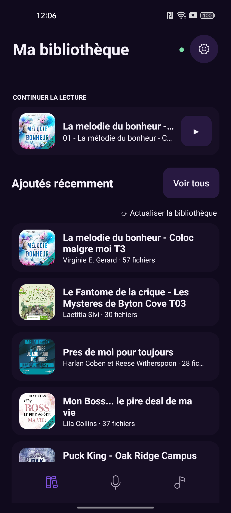
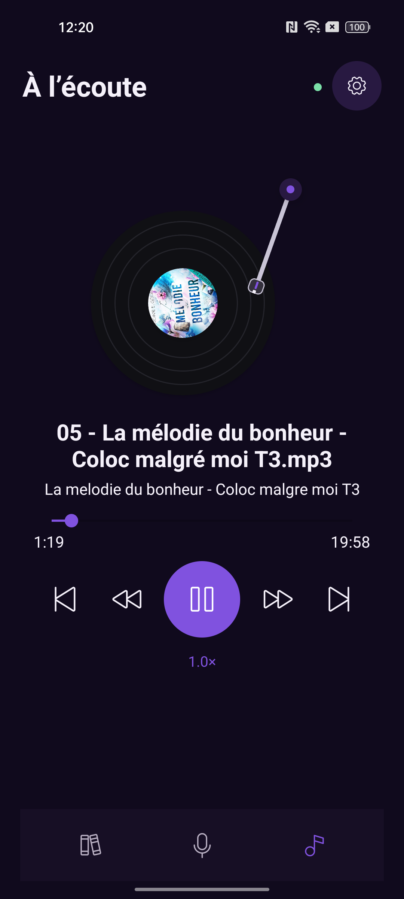
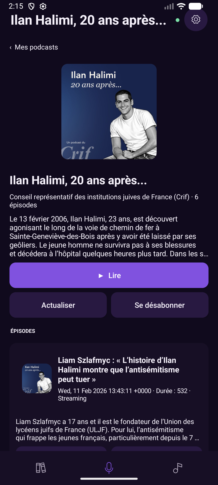
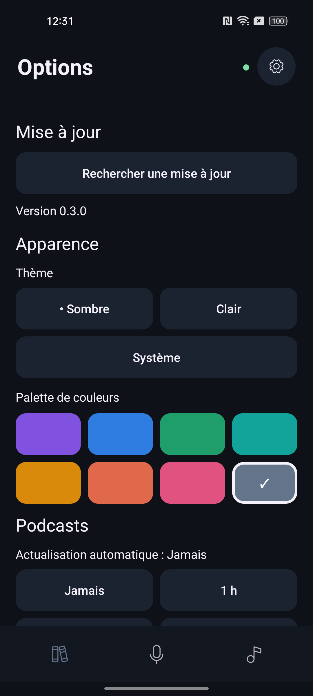

# AudiBook Player

**Vos livres audio et vos podcasts dans une application Android native, sans compte ni serveur à déployer.**

AudiBook Player réunit une bibliothèque de fichiers audio locaux, un lecteur à platine
vinyle animée et des abonnements aux podcasts. Les livres locaux et les épisodes déjà
téléchargés s’écoutent hors ligne; les services en ligne servent à découvrir des podcasts,
actualiser leurs flux, compléter les métadonnées des livres et récupérer les mises à jour.

[Télécharger un APK](https://github.com/cgreg21/audiobook-player/releases)
· [Signaler un problème](https://github.com/cgreg21/audiobook-player/issues)
· [Captures d’écran](#captures-décran)
· [Compilation](#compiler-le-projet)

## Le projet en bref

| Élément | Détail |
|---|---|
| Plateforme | Android 7.0 et versions ultérieures, API 24 minimum |
| Langage et interface | Kotlin, vues Android natives |
| Lecture audio | AndroidX Media3, ExoPlayer et MediaSession |
| Données locales | SQLite : bibliothèque, métadonnées, progression, abonnements et file de téléchargement |
| Import des livres | Sélecteur de dossiers Android avec autorisation d’accès persistante |
| Métadonnées de livres | Tags des fichiers, puis enrichissement manuel via Open Library |
| Podcasts | Recherche Apple Podcasts et lecture des flux RSS |
| Distribution | APK dans les releases GitHub |

Le dépôt contient uniquement la version Android native. L’ancien projet
NativeScript/Angular a été retiré : Node.js, npm et NativeScript ne sont pas nécessaires.
L’identifiant Android `org.nativescript.audiobookplayer` est conservé; son nom ne signifie
pas que l’application dépend encore de NativeScript.

## Captures d’écran

Ces captures réelles ont été réalisées pendant le développement de la version native.
Elles illustrent la bibliothèque, le lecteur, les podcasts et la personnalisation.
Elles précèdent certains ajustements récents : hauteur de l’en-tête, bouton d’arrêt,
tiroir des chapitres et navigation par catégories. Elles ne constituent donc pas une
représentation exacte de tous les écrans de la dernière révision.

<table>
  <tr>
    <th>Bibliothèque et reprise</th>
    <th>Lecteur à platine vinyle</th>
  </tr>
  <tr>
    <td></td>
    <td></td>
  </tr>
  <tr>
    <th>Fiche podcast et épisodes</th>
    <th>Thèmes et palettes</th>
  </tr>
  <tr>
    <td></td>
    <td></td>
  </tr>
</table>

Les œuvres et illustrations visibles appartiennent à leurs ayants droit respectifs.
Aucun livre audio ni épisode n’est fourni avec l’application.

## Fonctionnalités

### Bibliothèque de livres audio

- Import d’un dossier et exploration récursive de ses sous-dossiers.
- Constitution d’un livre par dossier contenant des fichiers audio, avec tri naturel
  des pistes : un chapitre 2 est placé avant un chapitre 10.
- Reconnaissance des extensions MP3, M4A, M4B, AAC, OGG, OGA, OPUS, FLAC et WAV,
  ainsi que des fichiers déclarés avec un type MIME audio. Le décodage effectif dépend
  des codecs disponibles sur l’appareil.
- Affichage des couvertures, auteurs et nombre de fichiers.
- Reprise du dernier livre écouté et accès rapide aux livres de la bibliothèque.
- Recherche dans les titres, les auteurs et les noms de pistes.
- Filtres **Tout**, **Non lus**, **Lus** et **En cours**; tri par titre ou écoute récente.
- Navigation multiniveau : **Tous les livres**, **Auteurs**, **Genres**, **Séries**,
  puis sélection d’un groupe et ouverture de la fiche du livre.
- Suggestions locales dans les fiches : **Dans la même série**, **Du même auteur**
  et **Dans les mêmes genres**. Les sections sans résultat sont masquées.
- Marquage manuel d’un livre comme lu ou non lu.

La bibliothèque scannée est conservée localement. Un changement d’onglet ou une
réouverture ne déclenche pas un nouveau scan : utilisez **Actualiser la bibliothèque**
après avoir ajouté, déplacé ou supprimé des fichiers.

### Lecteur et chapitres

- Lecture/pause, piste précédente/suivante, sauts temporels et déplacement dans la piste.
- Vitesse de **0,75× à 2×**, mémorisée entre les sessions.
- Sauvegarde de la piste et de la position pour reprendre l’écoute.
- Platine vinyle animée avec couverture centrale et bras suivant la progression.
- Mini-lecteur avec couverture, titre, lecture/pause et barre de progression.
- Tiroir de chapitres partagé entre le lecteur et la fiche livre : ouverture au toucher
  ou par glissement, sélection d’une piste et indication **En cours** ou **Terminé**.
- Marquage des chapitres terminés lors du passage automatique au suivant et à la fin
  de la dernière piste.
- Lecture en arrière-plan avec service Android et notification multimédia.
- Bouton **Arrêter et fermer le livre** : sauvegarde la position, arrête la lecture
  et vide la playlist, sans supprimer le livre.

La lecture continue quand l’activité passe en arrière-plan. Elle s’arrête lorsque
l’application est retirée des applications récentes. Le bouton ou geste **Retour**
ferme d’abord un tiroir ouvert, puis remonte l’historique des pages.

### Métadonnées et couvertures des livres

Les tags locaux fournissent le titre d’album, l’auteur, les titres des pistes et la
pochette lorsqu’ils sont présents. Ils restent prioritaires.

Une recherche **manuelle** dans Open Library permet de sélectionner un résultat pour
compléter les informations manquantes : titre, auteur, couverture, sujets utilisés comme
genres et série de l’édition lorsque disponibles. Les informations choisies sont
enregistrées dans SQLite, **sans modifier les fichiers audio**.

Aucune recherche Open Library n’est lancée automatiquement à l’ouverture d’un livre.
Les listes, catégories et suggestions réutilisent les métadonnées en cache.

### Podcasts

- Recherche dans le catalogue Apple Podcasts et gestion des abonnements.
- Actualisation des informations depuis les flux RSS.
- Fiches avec couverture, auteur, description et liste d’épisodes.
- Affichage des résumés, dates, durées et images d’épisodes lorsque le flux les fournit.
- Consultation du texte complet des descriptions au toucher.
- Lecture en streaming ou depuis le fichier téléchargé.
- Actualisation manuelle ou vérification périodique des flux pendant l’exécution
  de l’application : **Jamais**, **1 h**, **6 h** ou **24 h**.

### Téléchargements et stockage

- File persistante avec progression, pause, reprise et annulation.
- Service de premier plan pour poursuivre les transferts lorsque l’écran est quitté
  ou l’activité fermée.
- Restauration de la file à la prochaine ouverture si Android a arrêté le processus.
- Reprise des fichiers partiels lorsque le serveur accepte les requêtes HTTP Range.
- Politique Wi-Fi uniquement ou autorisation des données mobiles.
- Suspension des téléchargements non autorisés lors du passage sur réseau mobile.
- Confirmation ponctuelle pour télécharger ou écouter un épisode en streaming
  sur le réseau mobile.
- Choix du stockage interne ou externe de l’application pour les prochains téléchargements.
- Affichage de l’espace utilisé, suppression d’un téléchargement ou nettoyage des
  épisodes téléchargés sans supprimer les abonnements.

### Personnalisation et mises à jour

- Thème **sombre**, **clair** ou **système**.
- Huit palettes : Violet, Océan, Forêt, Lagon, Ambre, Couchant, Rose et Ardoise.
- Vérification manuelle des releases GitHub depuis les options.
- Téléchargement de l’APK et ouverture de l’installateur Android après autorisation.

## Installation et premier lancement

1. Télécharger l’APK de la version souhaitée dans les
   [releases GitHub](https://github.com/cgreg21/audiobook-player/releases).
2. Ouvrir le fichier sur Android et autoriser son installation depuis la source utilisée
   si le système le demande.
3. Dans la bibliothèque, choisir **Ajouter un dossier**, sélectionner le dossier de
   livres audio et accorder l’accès via le sélecteur Android.
4. Ouvrir un livre puis lancer sa lecture. Pour les podcasts, utiliser l’onglet dédié
   pour rechercher un programme et s’y abonner.

Exemple d’organisation des fichiers :

```text
Livres audio/
  Auteur A/
    Premier livre/
      01 - Introduction.mp3
      02 - Chapitre 1.mp3
  Auteur B/
    Autre livre/
      01.m4b
```

Le nom du dossier sert de titre de secours lorsqu’aucune métadonnée de titre n’est
disponible. Le contenu audio reste dans le dossier sélectionné : l’import n’en fait
pas une copie.

Pour mettre à jour une installation existante sans la désinstaller, l’APK doit conserver
le même identifiant et être signé avec la même clé. La version debug utilise un
identifiant distinct (`org.nativescript.audiobookplayer.debug`) et peut coexister avec
la version distribuée.

## Réseau et données

| Usage | Destination ou stockage |
|---|---|
| Livres et progression | Fichiers locaux et base SQLite sur l’appareil |
| Recherche de livres demandée par l’utilisateur | Open Library : titre et auteur lorsqu’il est connu |
| Recherche de podcasts | Apple Podcasts : termes de recherche |
| Flux, streaming et téléchargements | Serveurs des éditeurs de podcasts |
| Couvertures de podcasts | Adresses fournies par le catalogue ou les flux; cache mémoire/disque |
| Vérification des mises à jour | API des releases GitHub de ce dépôt |

Les nouvelles couvertures de podcasts ne sont pas téléchargées sur réseau mobile
si le réglage limite l’usage au Wi-Fi; celles déjà en cache restent utilisables.
Une recherche Open Library sur le réseau mobile demande également confirmation lorsque
cette restriction est active. Ce réglage n’est pas un pare-feu global pour toutes les
requêtes de l’application.

L’accès au dossier repose sur le Storage Access Framework Android. Les notifications
servent à la lecture et aux téléchargements; l’autorisation d’installer des applications
n’est nécessaire que pour ouvrir une mise à jour téléchargée depuis l’application.

## Architecture

```text
android-native/
  app/
    src/main/
      java/org/nativescript/audiobookplayer/
      res/
      assets/
      AndroidManifest.xml
    src/androidTest/
    build.gradle.kts
  gradle/wrapper/
  gradlew
  gradlew.bat
  settings.gradle.kts
docs/screenshots/
```

| Composant | Responsabilité |
|---|---|
| `MainActivity` | Interface native, navigation, fiches, lecteur et tiroirs |
| `AudioLibrary` | Scan des dossiers, ordre des pistes et sérialisation de la bibliothèque |
| `LibraryDatabase` | Persistance SQLite et migrations du schéma |
| `LibraryCategories`, `RelatedBooks` | Catégories typées, normalisation et suggestions locales |
| `BookMetadataRepository`, `OpenLibraryMetadataRepository` | Tags locaux et enrichissement Open Library |
| `PlaybackService` | ExoPlayer, MediaSession, progression et fin des chapitres |
| `PodcastRepository`, `PodcastFeedParser` | Recherche, abonnements et parsing RSS |
| `PodcastArtworkLoader` | Chargement asynchrone et caches des couvertures |
| `PodcastDownloadQueue`, `DownloadForegroundService` | File persistante, transferts et notifications |
| `AppUpdateManager` | Recherche et téléchargement des mises à jour GitHub |

Les états de lecture sont lus par lots pour les filtres et le tri récent. Les couvertures
du lecteur ne sont rechargées qu’au changement de source ou à l’actualisation des
métadonnées. Le cache de bibliothèque évite de relire les fichiers à chaque affichage.

## Compiler le projet

### Prérequis

- Android Studio ou un environnement Android SDK équivalent.
- JDK 17 ou version ultérieure compatible avec le projet.
- SDK Android 36 et Build Tools correspondants.
- Un appareil Android ou un émulateur pour exécuter l’application et les tests instrumentés.

Ouvrir le dossier `android-native` dans Android Studio, ou utiliser le wrapper Gradle
fourni. Configurer le SDK via Android Studio, `ANDROID_HOME` ou un fichier local
`android-native\local.properties` contenant `sdk.dir`. Ne pas versionner ce fichier.

### Build debug sous Windows

Depuis la racine du dépôt, dans PowerShell :

```powershell
$env:JAVA_HOME = 'C:\Program Files\Android\Android Studio\jbr'
.\android-native\gradlew.bat -p .\android-native :app:assembleDebug
```

APK produit :

```text
android-native\app\build\outputs\apk\debug\app-debug.apk
```

Installation sur un appareil connecté avec le débogage USB activé :

```powershell
adb install -r .\android-native\app\build\outputs\apk\debug\app-debug.apk
```

Sous Linux ou macOS, utiliser `bash ./android-native/gradlew -p android-native`
à la place de l’appel au fichier `.bat`.

### Tests instrumentés

Avec un appareil ou un émulateur connecté :

```powershell
.\android-native\gradlew.bat -p .\android-native :app:connectedDebugAndroidTest
```

Les tests couvrent notamment les métadonnées en cache, le classement et les suggestions,
les états de lecture par lots, le parsing RSS et la migration des données de podcasts.
Pour compiler les tests sans les exécuter :

```powershell
.\android-native\gradlew.bat -p .\android-native :app:assembleDebugAndroidTest
```

### Publication d’une release

Le workflow [Release Android APK](.github/workflows/release.yml) s’exécute lors d’un
push sur `master`, ou manuellement avec un choix de version beta/stable. Il calcule la
version, construit l’APK natif signé et le joint à une release GitHub.

Deux secrets du dépôt sont nécessaires :

| Secret | Contenu |
|---|---|
| `KEYSTORE_BASE64` | Keystore de signature persistant, encodé en Base64, avec l’alias `release` |
| `KEYSTORE_PASSWORD` | Mot de passe du keystore et de la clé `release` |

Conserver la même clé entre les releases pour permettre les mises à jour des installations.
Ne jamais versionner le keystore ni ses mots de passe. Sans configuration de signature,
un build release local n’est pas un APK signé prêt à être distribué.

## Limites et dépannage

| Situation | Vérification |
|---|---|
| Des livres ajoutés ne sont pas visibles | Lancer **Actualiser la bibliothèque** |
| Un dossier n’est plus accessible | Vérifier qu’il existe encore et le sélectionner de nouveau si nécessaire |
| Titre, auteur ou couverture manquants | Vérifier les tags audio ou lancer une recherche Open Library depuis la fiche |
| Une série ou un genre est absent | Ces informations dépendent des métadonnées disponibles; aucune série n’est déduite des noms de dossiers |
| Un téléchargement ne reprend pas au même octet | Le serveur doit prendre en charge les requêtes HTTP Range |
| Un transfert est en attente sur réseau mobile | Vérifier la politique réseau et l’autorisation ponctuelle de l’épisode |
| Un format audio reconnu ne se lit pas | Vérifier le codec du fichier et sa prise en charge par l’appareil |
| Une mise à jour ne s’installe pas | Vérifier la permission d’installation, l’identifiant et la clé de signature |

Les M4B sont traités comme des pistes audio : la navigation décrite ici repose sur les
fichiers du livre, sans extraction annoncée des chapitres internes d’un conteneur.
La fréquence d’actualisation des podcasts n’est pas une garantie de réveil périodique
quand le processus de l’application est arrêté.

## Contributions et crédits

Pour signaler un problème, ouvrir une [issue](https://github.com/cgreg21/audiobook-player/issues)
avec la version de l’application, la version Android et les étapes de reproduction.
Éviter de joindre des données personnelles ou des fichiers audio protégés.

Le projet utilise notamment AndroidX Media3, les métadonnées et couvertures
[Open Library](https://openlibrary.org), le catalogue Apple Podcasts et les flux
publiés par les éditeurs. Pour Open Library, consulter les
[règles d’utilisation des API](https://openlibrary.org/developers/api)
et les [conditions du service de couvertures](https://openlibrary.org/dev/docs/api/covers).
